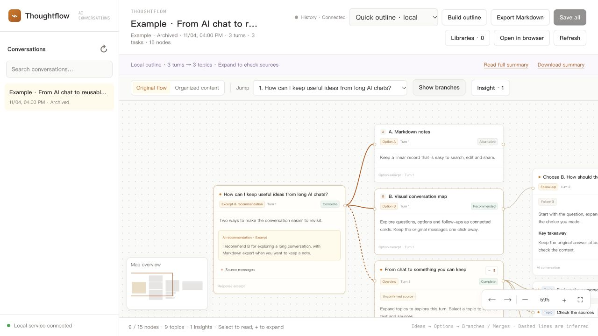

# Thoughtflow

**Turn long AI conversations into a map you can explore.**

[English](README.md) · [简体中文](README.zh-CN.md)

Ideas get buried in long chats. Thoughtflow gives your conversation a visual structure: questions, options, decisions, follow-ups and research topics. Read the original responses, check where a summary came from, and keep the parts you need as Markdown.

The interface is in English. Your messages stay in their original language, and AI summaries follow the main language of the conversation.




Actual interface with fictional example content.

## What it does

- **Explore a conversation:** pan and zoom through cards, expand topics and follow branches. Inferred connections use dashed lines and can be corrected.
- **Quick outline:** create source-linked excerpts locally, without waiting for a model. Original messages remain available.
- **Optional AI summary:** rewrite an exchange into a concise document with references to its source turns.
- **Keep useful content:** download Markdown, or preview and save selected cards or a full conversation to a connected library.
- **Follow updates:** local Codex history updates as messages are persisted. Other supported hosts update when the agent calls the sync script.

This maps the structure of visible messages; it does not expose a model's private reasoning.

## Get started

Requirements: **Python 3.10+**, a local browser, and an AI client allowed to run local scripts. The core app uses the Python standard library. Some compressed Codex history requires system Zstandard support.

1. Download this repository as a ZIP and extract it.
2. Install the **entire** `skills/thoughtflow/` folder using your client's local skill importer or skill directory. Copying only `SKILL.md` is not enough.
3. Start a new chat and ask: **“Use thoughtflow to open a map of this conversation.”**

For a Codex installation using `~/.codex/skills/`, copy the folder to `~/.codex/skills/thoughtflow/`. Claude Code can load the repository with `claude --plugin-dir /path/to/thoughtflow`, or use the complete skill folder under `~/.claude/skills/`. Other hosts should use their local skill import flow; execution permissions depend on the client.

To run manually, from `skills/thoughtflow/`:

```sh
python3 scripts/launch.py --open
```

Select a local Codex conversation from the sidebar. An explicit conversation ID is also supported:

```sh
python3 scripts/launch.py --thread CONVERSATION_UUID --open
python3 scripts/launch.py --stop
```

## Client support

| Client | How messages reach the map |
|---|---|
| Codex | Reads accessible local, persisted user-visible conversation history |
| Claude Code, WorkBuddy, Kimi Code, Qoder | The host agent explicitly syncs authorized messages through `sync_turn.py` |

The other-host adapters do **not** automatically scan those applications' chat histories. Updates depend on the host executing the skill. A web-only chatbot generally cannot start the local app. See [the skill instructions](skills/thoughtflow/SKILL.md) for the sync and summary JSON formats.

## Summaries and saved notes

The default **Quick outline** runs locally without any model or Codex installation. It keeps excerpts in original order and groups long conversations for navigation; it does not semantically merge or rewrite the discussion.

The optional **AI summary** mode uses a locally installed, signed-in Codex CLI (default `gpt-6.1-sol`, low reasoning, 120-second timeout; override the model with `THOUGHTFLOW_MODEL`). It sends the selected messages to that model service; the service's account limits and charges apply. Without Codex CLI, the host agent can call `prepare_summary.py` once, produce a source-grounded summary, and import it with `publish_summary.py`. A snapshot key prevents publishing against changed conversation content. WorkBuddy can batch-import existing history with `sync_history.py`, then sync only changed turns. Opening a map does not require summarizing the whole chat first. The input limit is 200,000 characters; oversized requests are rejected rather than silently truncated.

**Export Markdown** works without a library connection. **Save all** and card saves use connections the app can actually verify:

- **Obsidian:** an existing registered, writable vault.
- **Notion:** supported reusable API credentials or a compatible local MCP configuration.
- **GetNote (得到大脑):** a compatible Codex stdio MCP configuration.

Signing in inside another app does not necessarily make its credentials available here. Review the destination, content and tags before confirming a save. Uncertain saves reuse the same request ID when retried to reduce duplicate notes.

## Local data

The server listens only on `127.0.0.1`. It reads Codex history without modifying it. Imported messages and summary caches are stored outside the installation:

| System | Default data directory |
|---|---|
| macOS | `~/Library/Application Support/ThoughtFlow/` |
| Windows | `%LOCALAPPDATA%/ThoughtFlow/` |
| Linux | `$XDG_DATA_HOME/thought-flow/` or `~/.local/share/thought-flow/` |

`THOUGHT_FLOW_DATA_DIR` overrides this location. The existing directory names and internal service identifiers are retained for compatibility with earlier Thought Flow installations. The distribution contains no conversation history or credentials. AI reorganization and confirmed cloud saves send selected content to the corresponding services.

## License

Free for personal learning, personal use, internal organizational use and local modification. Resale or paid redistribution requires separate permission. Other uses require the rights holder's permission. This is a source-available project under [the existing license](LICENSE.txt), not an OSI open-source license. See [third-party notices](THIRD_PARTY.md).
