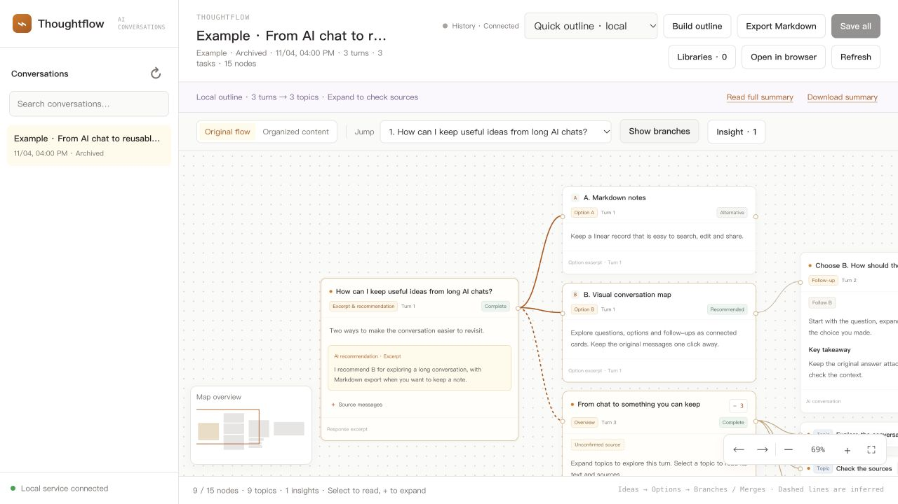

# Thoughtflow

[English](README.md) · [简体中文](README.zh-CN.md)

[下载安装包](https://github.com/hugo263/thoughtflow/releases/latest) · [查看源码](https://github.com/hugo263/thoughtflow)

把 AI 对话变成可以浏览、展开和保存的横向图谱。

新版默认使用英文界面；中文对话保持原文，AI 整理跟随原对话的主要语言。

Thoughtflow 将你选择的 AI 问答整理为本机可浏览的横向图谱：问题、备选方案、选择与后续讨论可以形成分支和合流；研究报告可展开为主题、细节与洞察。卡片可以直接阅读回答、展开可取得的工具记录，并在预览后保存到实际可用的知识库。你也可以重新梳理内容、把完整问答或整理稿作为 Markdown 一次保存。

真实界面，使用虚构示例对话。

## 需要什么

- 可在本机读写文件、运行命令的 Codex、WorkBuddy、Kimi Code、Qoder 或 Claude Code 客户端；纯网页聊天通常无法直接启动本机程序。
- Python 3.10 或更新版本和本机浏览器。核心程序只使用 Python 标准库；Codex 压缩历史可能需要系统的 zstd 支持。
- 已登录的 Codex CLI 可供图谱中的「重新梳理」按钮调用；非 Codex 宿主可以由当前 AI 按技能说明生成整理稿并同步进图谱。模型服务的账户用量、网络和费用由对应服务决定。
- 保存到知识库需要用户自己的有效连接和对应权限；本包不包含账号、令牌或示例数据。

## 安装

解压整份 ZIP，保留全部目录。`skills/thoughtflow/` 是可独立安装的完整技能目录，里面包含 `SKILL.md`、本机程序及网页源码；不能只复制 SKILL.md。

- **Codex**：按客户端支持的本地插件方式加载根目录 `plugin.json`；或将完整的 `skills/thoughtflow/` 安装到 Codex 的技能目录。新对话中使用“用 thoughtflow 打开这段对话的图谱”。
- **Claude Code**：插件清单位于 `.claude-plugin/plugin.json`；可以通过 `claude --plugin-dir <解压后的目录>` 临时加载，或根据 Claude Code 插件说明安装。也可将完整技能目录安装到 `~/.claude/skills/thoughtflow/`。
- **Qoder**：插件清单位于 `.qoder-plugin/plugin.json`。也可将完整技能目录放到 `~/.qoder/skills/thoughtflow/`；QoderWork 使用 `~/.qoderwork/skills/thoughtflow/`。重启或刷新技能列表。
- **WorkBuddy**：通过技能管理的本地导入功能导入完整 `skills/thoughtflow/` 目录（包括辅助文件）；根目录另提供 `.codebuddy-plugin` 清单，实际插件加载方式以客户端版本为准。
- **Kimi Code**：将完整技能目录放到 `~/.kimi-code/skills/thoughtflow/` 或按 Kimi Code 文档指定的共享技能目录安装。Kimi 普通网页聊天不能直接运行这个本地程序。

首次使用可以请客户端“用 thoughtflow 打开当前对话的图谱”。客户端的技能加载和执行权限依其版本及设置而异。如需手动启动：在 `skills/thoughtflow/` 目录执行 `python3 scripts/launch.py --open`；停止服务执行 `python3 scripts/launch.py --stop`。

## 会话读取和实时更新

Codex：只读本机可访问的 Codex 历史，监听其已持久化的公开事件；对话继续写入时页面更新。可从列表选择历史会话。系统可能不能读取部分压缩或不可确认来源的会话，页面会提示。

WorkBuddy、Kimi Code、Qoder、Claude Code：由宿主技能在用户授权时同步当前会话的**公开**问题、回答和可选工具记录；宿主每次调用同步脚本时图谱更新。它不会在后台自动扫描这些客户端的历史，也不保证宿主每次回答都自动调用技能。用户可请当前宿主“同步并更新思考图谱”，或明确授权同步其可见历史。不同会话使用不同标识。图谱呈现公开内容的结构与摘录，不能读取或还原模型未公开的内部推理。

## 快速提纲、AI 整理与知识库

默认 Quick outline（快速提纲）在本机按原顺序生成摘录与来源索引，不调用模型，也不要求安装 Codex。它不会替代 AI 的语义合并。打开图谱不应先让模型重写整个对话。

AI summary 为可选精炼模式：默认使用 gpt-6.1-sol、low 推理档位，120 秒超时；可通过 THOUGHTFLOW_MODEL 指定其他模型，不修改聊天客户端的全局模型设置。

WorkBuddy 初次同步历史可通过 sync_history.py 一次批量导入，之后只更新变化的轮次。没有 Codex CLI 时，当前宿主可调用 prepare_summary.py 取得带来源编号和快照标识的输入，再用 publish_summary.py 提交一次精简整理。失败时仍能使用本地提纲。

「重新梳理」合并重复或没有实质内容的往返，整理目标、结论、选择、来源及待确认事项；原始记录保留。AI summary 模式调用本机已登录 Codex CLI，单次最多处理 20 万字符；其他宿主可按技能中的 `publish_summary.py` 方法使用自己的 AI 生成并导入整理稿。整理稿会带有来源轮次，新对话内容到来后可能过期。

「全部保存」可预览并以 Markdown 保存完整问答或整理稿，附上可编辑标签。仅显示经程序实际检测到可用的连接：Obsidian 需已注册且可写的库；得到大脑当前使用兼容的 Codex MCP 配置；Notion 需要可复用的令牌或兼容 MCP 配置。其他客户端里已登录，并不一定意味着这个独立程序可以读取其授权。用户选择目标与确认前不会创建笔记；若没有可用连接，仍可用 Export Markdown 下载完整问答。

## 隐私和数据位置

服务仅监听 `127.0.0.1`；图谱原始数据保存在本机，默认 macOS 位于 `~/Library/Application Support/ThoughtFlow/`，Windows 位于 `%LOCALAPPDATA%/ThoughtFlow/`，Linux 位于 `$XDG_DATA_HOME/thought-flow/`（未设置时为 `~/.local/share/thought-flow/`）。可用 `THOUGHT_FLOW_DATA_DIR` 自行指定。Codex 历史只读，用户主动同步的其他客户端公开问答会存入本地数据目录。AI 整理会把选定问答交给当前使用的模型服务；知识库保存仅在用户确认后提交所选内容。请不要同步密码、令牌或未授权的内容。

源码包不包含字体文件。界面优先使用本机 IBM Plex Sans、JetBrains Mono，缺失时使用系统字体；文字和配色仍可显示。产品图标为文本格式矢量标识。授权使用规则见 `LICENSE.txt`；第三方名称见 `THIRD_PARTY.md`。本包未承诺专门技术支持或服务时效。
